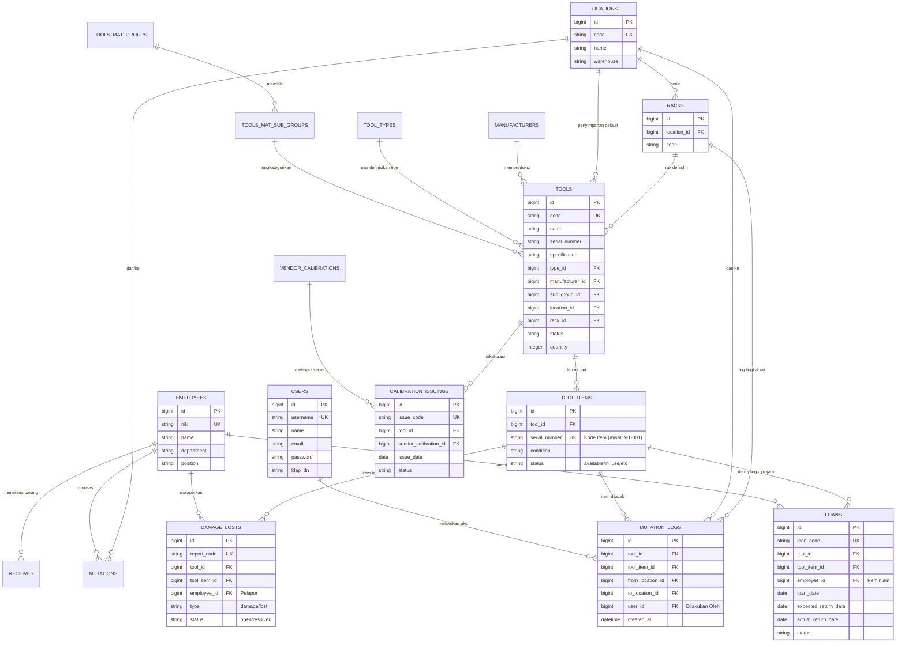

# Sistem Manajemen Gudang - ERD Lengkap

Dokumen ini memberikan representasi visual detail dari skema database untuk proyek **WarehouseLoan_lBE**, yang disusun berdasarkan modul fungsional.

## Diagram Hubungan Entitas (ERD)

## Ikhtisar Modul

### 📦 Data Master
Mengelola entitas inti seperti **Tools** (Alat), **Locations** (Lokasi), dan **Manufacturers** (Produsen). Item individual dilacak melalui **Tool Items** untuk kontrol yang lebih granular.

### 👤 Personel
Mengelola **Users** (Akses sistem) dan **Employees** (Interaksi fisik dengan alat seperti peminjaman atau penerimaan).

### 🔄 Transaksi
Mencatat siklus hidup aset:
- **Loans (Peminjaman)**: Peminjaman item saat ini dan riwayatnya.
- **Mutations (Mutasi)**: Jejak audit untuk perpindahan internal.
- **Damage/Lost (Rusak/Hilang)**: Manajemen item yang bermasalah atau hilang.
- **Calibration (Kalibrasi)**: Jadwal pemeliharaan eksternal.
