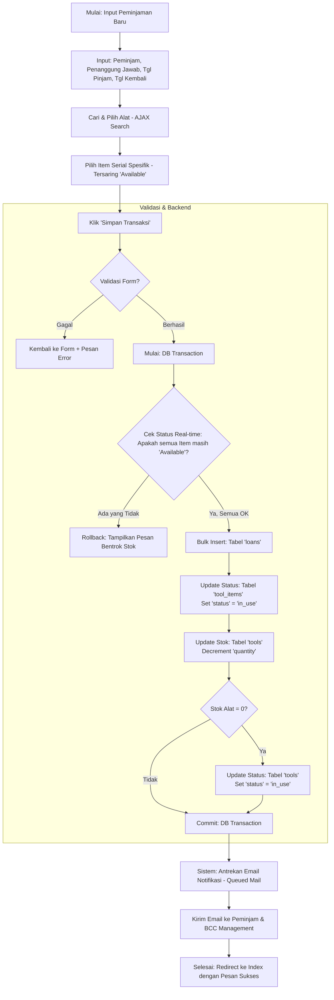
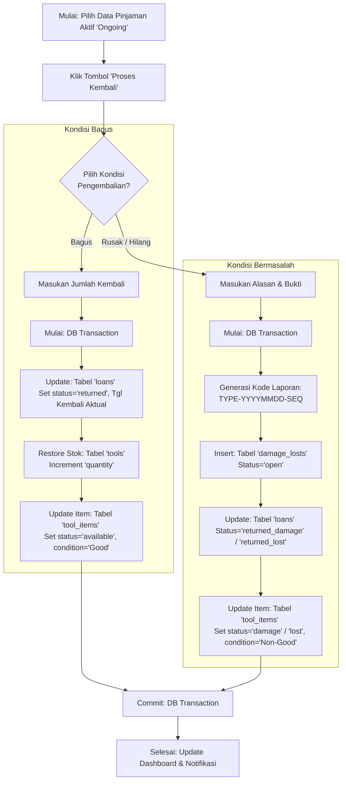
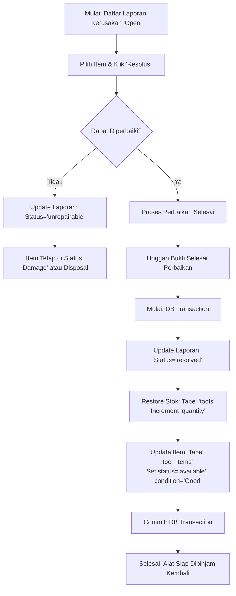

# Sistem Manajemen Gudang - Flowchart Detail (V2)

Dokumen ini menyediakan alur kerja teknis dan operasional yang mendalam untuk sistem **WarehouseLoan_lBE**.

## 1. Alur Teknis Peminjaman Alat (Loan)
Menjelaskan proses dari input pengguna hingga operasi database dan antrean email.

## 2. Alur Pengembalian & Penanganan Masalah (Return & Damage)
Menjelaskan logika percabangan saat alat dikembalikan oleh peminjam.

## 3. Alur Perbaikan Alat (Damage Resolution)
Proses memulihkan aset yang rusak kembali ke status siap pakai.

## Ringkasan Detail Teknis

| Proses | Validasi Kunci | Perubahan Database Utama |
| :--- | :--- | :--- |
| **Peminjaman** | Cek duplikasi status item (Concurrency). | `loans` (Ins), `tool_items` (Upd), `tools` (Upd). |
| **Pengembalian** | Validasi jumlah kembali <= jumlah sisa pinjam. | `loans` (Upd), `tools` (Inc), `tool_items` (Upd). |
| **Kerusakan** | Wajib melampirkan alasan dokumen referensi. | `damage_losts` (Ins), `tool_items` (Upd status). |
| **Kalibrasi** | Cek vendor aktif. | `calibration_issuings` (Ins), `tools` (Upd status). |
